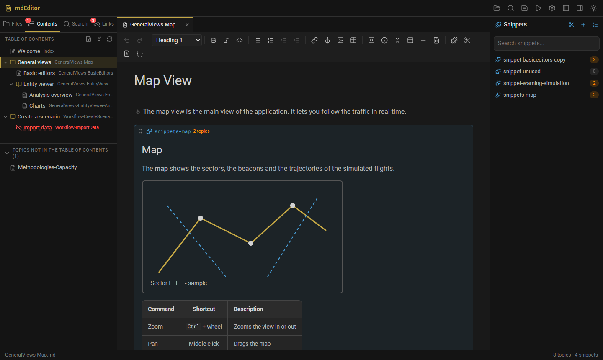

# mdEditor

**A WYSIWYG editor for MkDocs documentation, with first-class support for snippets and the site's table of contents.**



mdEditor edits the Markdown sources of an [MkDocs](https://www.mkdocs.org/) / [Material for MkDocs](https://squidfunk.github.io/mkdocs-material/) site directly in their rendered form. It understands the pymdownx extensions used by large documentation sets, especially `--8<--` snippet inclusions, and it writes back Markdown in the exact format the existing toolchain expects.

It is built for documentation sets with hundreds of topics and reusable blocks, where the hard part is keeping includes, links and navigation consistent, rather than typing text.

- **Rendered editing.** Admonitions, tabs, collapsible blocks, tables, images and code are edited as they appear on the site.
- **Snippets as live blocks.** Included content is shown and edited in place, saved to the snippet file, and kept in sync wherever it appears.
- **Navigation editing.** The table of contents (`Maps/table_of_contents.xml`) is a tree you can drag and drop, with validation of broken entries and orphan topics.
- **Safe by default.** External-change detection, a diff before saving, and deletions that list every reference first.
- **Zero install on workstations.** One folder to copy; it runs fully offline, on a local server that only listens on `127.0.0.1`.
- **Claude integration.** An MCP server gives an AI assistant the same structured access, with the same rules.

---

## Contents

- [Requirements](#requirements)
- [Getting started](#getting-started)
- [Using mdEditor](#using-mdeditor)
- [Exporting the website or a PDF](#exporting-the-website-or-a-pdf)
- [Configuration](#configuration)
- [Claude integration (MCP)](#claude-integration-mcp)
- [Markdown compatibility](#markdown-compatibility)
- [How it works](#how-it-works)
- [Development](#development)
- [Building a release](#building-a-release)
- [Project layout](#project-layout)
- [Known limitations](#known-limitations)
- [Changes](#changes)
- [License](#license)

## Requirements

| | Compiled version | From source |
|---|---|---|
| OS | Windows 10/11 | Windows 10/11 (macOS/Linux work for development, without native dialogs) |
| Browser | Microsoft Edge (shipped with Windows); Chrome as a fallback | same |
| Python | — (bundled) | 3.10+, standard library only |
| MkDocs | only for *Build & Preview* | same |
| Node.js | — | only to rebuild the UI: 20.19+ or 22.12+ |

## Getting started

### Compiled version

1. Unzip `mdEditor-<version>-windows.zip`. It contains a `mdEditor/` folder with `mdEditor.exe` (the editor), `mdeditor-mcp.exe` (MCP server), `mdeditor-cli.exe` (command line exports) and `_internal/` (keep them together).
2. Right-click `install.ps1` and choose *Run with PowerShell*. It needs no administrator rights:
   - installs into `%LOCALAPPDATA%\Programs\mdEditor`;
   - creates the Desktop and Start menu shortcuts;
   - adds the folder to your `PATH`, so `mdeditor-cli` works in any new terminal.

   With `-Mcp` (and optionally `-McpRoot D:\path\to\Help\Md`), it also registers the MCP server in Claude Code and Claude Desktop. `uninstall.ps1`, in the installation folder, undoes all of it and keeps your settings (`-RemoveSettings` removes them too).

   You can also run `mdEditor.exe` directly from the unzipped folder without installing anything, or `mdEditor.exe D:\path\to\Help\Md` to open a documentation folder.

The application starts in about half a second: nothing is unpacked at launch.

### From source

```
pythonw mdeditor.pyw                    # start screen
pythonw mdeditor.pyw D:\path\to\Help\Md # open a folder directly
```

To create Desktop and Start menu shortcuts for the source version, right-click `install-shortcut.ps1` and choose *Run with PowerShell*.

The launcher starts a local server on a free port and opens Edge in app mode (a window without an address bar). The server stops when the window is closed.

### Try it on the sample project

`sample/Help` is a small, fictional documentation set that covers every supported construct, snippets and a table of contents, including a broken entry and orphan files:

```
pythonw mdeditor.pyw sample/Help/Md
```

## Using mdEditor

### Projects

Open the documentation folder, the one that contains the `.md` topics (for example `Help/Md`), with **Open folder** (Ctrl+O) or from the recent folders on the start screen. mdEditor finds `mkdocs.yml` in that folder or up to two levels above. From it, mdEditor reads the snippet `base_path` and the theme's `extra_css`.

The left panel has four tabs:

| View | Content |
|---|---|
| **Files** | Topics grouped by file name prefix (`GeneralViews-EntityViewer-…`), snippets shown separately |
| **Search** | Project-wide search and replace, plain text or regex |
| **Links** | Broken links and snippet inclusions, and orphan files (see below) |
| **Contents** | The table of contents: the site navigation tree |

Both side panels can be resized by dragging their inner edge, or with the arrow keys once the edge has the focus. Double-click the edge to reset the width. Widths are remembered, and the editor always keeps room in a small window.

### Session

When you quit, mdEditor remembers where you were in each folder: the open tabs in their order, the active tab, the scroll position and the cursor of each tab, the expanded folders of **Files** and entries of **Contents**, and the side tab. Started again without a folder, it reopens the last one and restores all of that. Unsaved changes are not part of the session: closing the window still asks about them.

Both trees start fully collapsed; only what you expanded stays open. A topic opened from somewhere else (a link, Ctrl+P, the other tree, a search) is still revealed in the trees.

A loading screen covers the window while the folder is scanned and the session restored, so that the first clicks are not lost.

### Editing

Headings, emphasis, lists (Tab to indent), links (Ctrl+K: topics are suggested, and the anchors of a page as soon as you type `#`; Ctrl+click opens the target), `<a id>` anchors, tables (rows, columns, alignment, resizing), code blocks with syntax highlighting, admonitions (`!!!`), collapsible blocks (`???`), content tabs (`===`) and raw HTML, which is preserved as is.

**Heading anchors.** A heading can carry an attr_list identifier, `## Dates selection { #creatanalyss2 }`. The identifier is not part of the editable title. A discreet `#creatanalyss2` badge shows it, and you right-click the heading to add, change or remove it, or to copy a link to it. It is saved at the end of the line as `{ #id }` (an existing `{#id}` keeps its spelling). Links can target these identifiers and the ones MkDocs generates from the title text (`#dates-selection`).

**Links** keep the form they were written in: `[text](target)`, `<https://...>`, `<name@host>`, `<mailto:...>`, or HTML `<a href="...">`. HTML links, such as `<a href="mailto:...">` produced by converters, are editable links like the others, not raw HTML. Ctrl+click on a `mailto:` link opens the mail program.

**TODO markers.** The word `TODO` (upper case, whole word) is highlighted in the text. The **TODO** tab lists every TODO of the project, grouped by page, with a filter. A click opens the page and selects the TODO. Fenced code blocks are ignored; HTML comments (`<!-- TODO ... -->`) are listed.

You can drop or paste an image. The image file is copied into `images/` and inserted as an `` tag. Then you can:
- resize the image with its handle;
- double-click it to edit `src`, `alt`, the size and the title;
- right-click it for quick actions: original size, 50 %, fit to page, replace, open, copy path, delete.

### Snippets

- An included snippet (`--8<-- "_snippets/name.md"`) is shown inline with a label giving its name and how many topics use it.
- Edits made inline are saved to the snippet file, not to the topic. If the snippet is shared, you are warned first, with the list of affected topics.
- The same snippet shown in several places, in one or more tabs, stays in sync as you type.
- Double-click the label to open the snippet in its own tab.
- The **Snippets** panel (right) has search, usage counts, a preview on hover and drag-and-drop insertion. Right-click a snippet for *Show topics using it*.
- **Insert snippet** (Ctrl+Shift+I) opens a palette with a preview. **Extract to snippet** turns the selection into a new snippet file. **Detach** replaces an inclusion with its content.

### Table of contents

The site navigation lives in `Maps/table_of_contents.xml`, next to the documentation folder. mdEditor finds it automatically, or you can choose it in the project settings.

- **Tree view.** Titles with their topic IDs, sections and pages, and broken entries flagged. The tree starts collapsed. The topic being edited is highlighted, and revealed when it was opened from elsewhere (a link, Ctrl+P, the Files tree...).
- **Drag and drop** to reorder, move into another section, or change level. You can also drop a topic from the list of missing topics. Keyboard alternatives: Alt+arrows, and the context menu (move up/down, indent, outdent).
- **Keyboard**: Up/Down to select, Enter to open, F2 to rename, Delete to remove from the menu.
- **Rename** with F2, or by clicking the title of the selected entry. **Add topic** creates the `.md` file with its title and the menu entry in one step. You can also duplicate an entry, remove it from the menu (the file is kept), or delete the topic.
- **Validation.** Entries pointing to a missing file are flagged, and topics that are not in the table of contents are listed, ready to be added.

Every attribute and comment of the XML is preserved. The `modified` attribute is updated on a move or rename, in the format the file already uses.

### Links, orphans and safe deletion

- **Broken links**: links and inclusions whose target does not exist.
- **Orphan files**:
  - topics that no page links to and that are not in the table of contents;
  - snippets that no file includes.
- **Deleting a file** first lists everything that still points to it (links with line numbers, snippet inclusions, table of contents entries) and asks for confirmation.

### Saving and preview

- Ctrl+S saves the current tab together with the modified snippets it includes. Ctrl+Shift+S saves everything.
- **Changes made outside the editor** (Claude, Git, another program) are detected within two seconds, even while you stay in the window. Snippets shown inline are checked too.
  - With no unsaved changes, the file is reloaded in place: the scroll position and the cursor are kept.
  - With unsaved changes, you choose between *Keep my changes* and *Reload and lose my changes*. If you keep them, you are not asked again for that version, and saving asks before overwriting the other one.
- **Diff** shows exactly what will be written, and **Source** shows the generated Markdown.
- **Build & Preview** runs `mkdocs serve` and opens the current page in the browser.

## Exporting the website or a PDF

The **Export** button (title bar) builds the documentation with MkDocs. The documentation folder is never modified.

- **Website**: one `.html` file per `.md` file, with the same name (`GeneralViews-Map.md` becomes `GeneralViews-Map.html`), and relative links, so the folder can be opened from the disk or copied to a web server. The navigation follows the table of contents. A **Contents** page listing it comes first in the menu: `contents.html`, or `index.html` when the project has no `index.md` (otherwise `index.html` stays the home page). The output folder is emptied first, so only an empty folder, the `site_dir` of `mkdocs.yml` or a previous export is accepted.
- **PDF**: one file with the contents on the first page, then one page per topic, in the order of the table of contents. Links between pages work inside the PDF. Edge prints it from the built site.

The same exports are available from the command line, without opening the editor. This is useful in a build script:

```
mdeditor-cli export-html D:\path\to\Help\Md D:\path\to\website
mdeditor-cli export-pdf  D:\path\to\Help\Md D:\path\to\Documentation.pdf
```

From source, use `python server/cli.py` with the same arguments. `--no-toc` keeps the navigation of `mkdocs.yml`. The exit code is 0 on success, 1 when the export failed, and 2 for wrong arguments.

Both need MkDocs with the site's plugins (`pip install mkdocs-material`). If MkDocs is installed in a specific Python environment, set `MDEDITOR_MKDOCS` to its `python.exe` or `mkdocs.exe`.

### Keyboard shortcuts

| Shortcut | Action |
|---|---|
| Ctrl+S / Ctrl+Shift+S | Save / save all |
| Ctrl+P | Open a topic or snippet |
| Ctrl+O | Open a folder |
| Ctrl+K | Insert or edit a link |
| Ctrl+Shift+I | Insert a snippet |
| Ctrl+Shift+F | Search in the project |
| Ctrl+Tab / Ctrl+Shift+Tab | Next / previous tab |
| Alt+W | Close the tab |
| F2 / Delete | Rename / remove from the menu the selected table of contents entry |
| Alt+arrows | Move the selected table of contents entry (up, down, indent, outdent) |

## Configuration

mdEditor never writes configuration into the documentation folder. Settings are stored per user in `%APPDATA%\mdEditor\settings.json`: project settings, recent folders, interface preferences (theme, panel widths, side tab) and the session of each folder (see [Session](#session)).

| Setting | Where | Default |
|---|---|---|
| Snippet folder | Project settings | `<root>/_snippets` |
| Snippet `base_path` | Project settings | `pymdownx.snippets.base_path` from `mkdocs.yml`, else the root |
| Table of contents file | Project settings | `Maps/table_of_contents.xml` next to or inside the root |
| Theme (dark/light), project CSS | Theme menu | Dark; project CSS off |
| Interface language | Theme menu | Automatic (Windows language) |
| Panel widths and visibility, side tab | Drag the panel edge, title bar buttons | 280 / 270 px, both panels shown, Files |
| Session (tabs, scroll, expanded trees) | Saved automatically, per folder | Empty: trees collapsed |

### Interface language

The interface ships in English and French. Translations are plain JSON files, so you can change any text without rebuilding. Drop a `<code>.json` file in one of these folders:
- `%APPDATA%\mdEditor\lang\`, for one user. The theme menu entry *Open custom language folder…* opens it.
- a `lang\` folder next to `mdEditor.exe`, for every user of that installation.

Files are merged key by key, so a file only needs the texts it changes. A new code, such as `de.json`, adds a language. The format is described in [doc/i18n.md](doc/i18n.md).

## Claude integration (MCP)

`mdeditor-mcp.exe` (or `server/mcp_server.py`) is a [Model Context Protocol](https://modelcontextprotocol.io/) server. It lets Claude Code, Claude Desktop or any MCP client work on the documentation with the editor's rules: snippet folder and `base_path`, `` tags, no front matter, UTF-8 and LF, conflict detection. It uses stdio and the standard library only, and the editor does not need to be open.

| Tool | Purpose |
|---|---|
| `set_project`, `project_info` | Open a documentation folder, show its settings |
| `list_files` | Topics and snippets, with usage counts and the `--8<--` line of each snippet |
| `read_file` | Read a file; `expand_snippets` returns the final content with snippets expanded |
| `write_file` | Write a file; refused if it changed since it was read; warns when the snippet is shared |
| `create_snippet`, `insert_snippet`, `extract_to_snippet` | Create, include and extract snippets |
| `snippet_usage`, `find_references` | What includes a snippet; everything that points to a file |
| `search`, `check_links` | Search; broken links and orphan files |
| `list_todos` | Every TODO marker left in the pages (file, line, text) |
| `get_toc`, `edit_toc` | Read and edit the table of contents (deleting a referenced topic requires explicit confirmation) |

**Claude Code**

```
claude mcp add mdeditor -- "C:\path\to\mdEditor\mdeditor-mcp.exe" --root "D:\path\to\Help\Md"
```

**Claude Desktop** (`%APPDATA%\Claude\claude_desktop_config.json`)

```json
{
  "mcpServers": {
    "mdeditor": {
      "command": "C:\\path\\to\\mdEditor\\mdeditor-mcp.exe",
      "args": ["--root", "D:\\path\\to\\Help\\Md"]
    }
  }
}
```

From source, use `"command": "python"` and put `server/mcp_server.py` first in `args`. Without `--root`, the server opens the folder last used in the editor, with its settings.

## Markdown compatibility

The editor parses Markdown into a document model and serializes it back. The rendered result is unchanged, and the following is guaranteed:

- images as HTML ``, never ``;
- anchors as `<a id="..."></a>`, heading identifiers as `## Title { #id }`, line breaks as `<br>`, pipe tables;
- links in their original form (Markdown, autolink `<...>`, HTML `<a href>`);
- `--8<-- "..."` inclusions, line and block forms (`;--8<--` disabled inclusions are kept);
- admonitions, details and tabs with 4-space indentation (Python-Markdown);
- unknown HTML preserved verbatim;
- no front matter; UTF-8 without BOM, LF line endings, no trailing spaces.

The source may be normalized on the first save of a file: table column alignment, `*italic*` instead of `_italic_`, escapes. Unmodified files are never rewritten, and the diff view shows the exact output beforehand. Details are in [doc/markdown-format.md](doc/markdown-format.md).

## How it works

```
mdEditor.exe ─► Python server (127.0.0.1, free port) ─► Edge --app window
                  │  JSON API  /api/*                     │  TypeScript UI (TipTap / ProseMirror)
                  │  static UI (web/dist)                 │  markdown-it + pymdownx rules
                  ▼
           documentation folder (Help/Md, Maps/table_of_contents.xml)
                  ▲
mdeditor-mcp.exe ─┘  stdio, same project model
```

- **Server** (`server/`): Python standard library only. It handles the project model (files, snippet usage, links, orphans), safe file writes with conflict detection, table of contents editing, and launching the window. It is shut down by a watchdog when the window closes.
- **UI** (`web/`): Vite and TypeScript, without a UI framework. A custom Markdown parser and serializer sit around TipTap nodes for each MkDocs construct. A shared store keeps every view of a snippet in sync.
- **Security**: the server only listens on `127.0.0.1` and rejects cross-origin writes. Every path is resolved against the project roots, and nothing is fetched from the network.

The architecture is described in [doc/architecture.md](doc/architecture.md).

## Development

```
cd web
npm install
npm run dev            # UI with hot reload on http://localhost:5173 (proxies the API)
```

In another terminal:

```
python server/app.py sample/Help/Md --port 8765 --no-window
```

| Check | Command | What it covers |
|---|---|---|
| Types | `npm run typecheck` (in `web/`) | TypeScript, including translation keys |
| Unit | `npm test` (in `web/`) | Markdown round trip on every sample file and on targeted cases; language files |
| Server | `python server/test_toc.py` | Table of contents read/write, every operation, orphans, references, deletion guard |
| MCP | `python server/test_mcp.py` | Every MCP tool over stdio |
| Export | `python server/test_export.py` | Navigation from the table of contents, output folder safety; with MkDocs (`MDEDITOR_MKDOCS`): real website and PDF |
| End to end | `node tests/e2e.mjs <copy>/Help/Md <screenshots>` (in `web/`) | The real UI in headless Edge, against a server on port 8799 |

The server tests run on a temporary copy of `sample/`. Run the end-to-end test against a copy too, never against `sample/` itself.

`web/dist` is committed, because it is what the application serves. Rebuild it with `npm run build` after any UI change.

Conventions and pitfalls for contributors are in [CLAUDE.md](CLAUDE.md), and the developer documentation is in [`doc/`](doc/):

| Document | Topic |
|---|---|
| [architecture.md](doc/architecture.md) | Modules, data flow, window life cycle |
| [markdown-format.md](doc/markdown-format.md) | Parser and serializer, output guarantees, adding a construct |
| [snippets.md](doc/snippets.md) | Paths and `base_path`, usage index, snippet store |
| [toc.md](doc/toc.md) | Table of contents, orphan files, deletion guard |
| [api.md](doc/api.md) | HTTP API and MCP tools |
| [i18n.md](doc/i18n.md) | Language files and `t()` |
| [build-release.md](doc/build-release.md) | Packaging and release checklist |

## Building a release

On the build machine only:

```
pip install pyinstaller
python build.py              # rebuilds the UI (Node.js), then the executables
python build.py --skip-web   # reuses web/dist
```

The output is `release/mdEditor/` (three executables sharing `_internal/`) and `release/mdEditor-<version>-windows.zip`. See [doc/build-release.md](doc/build-release.md) for the release checklist.

Unsigned PyInstaller executables are sometimes flagged by corporate antivirus software. Sign them with a company certificate or have them allow-listed.

## Project layout

```
mdeditor.pyw            launcher (no console)
server/
  app.py                HTTP server, project model, launcher, watchdog
  toc.py                table of contents (Maps/table_of_contents.xml)
  export.py             website and PDF export (MkDocs, Edge)
  cli.py                command line (mdeditor-cli)
  mcp_server.py         MCP server (stdio)
  test_toc.py, test_mcp.py
web/
  src/boot.ts           entry point: loads the language, then the app
  src/main.ts           layout, shortcuts, wiring
  src/markdown/         Markdown parser and serializer
  src/editor/           TipTap nodes (snippet, image, admonition, tabs, raw HTML...)
  src/snippets/         shared snippet store
  src/app/              tabs, panels (files, search, links, table of contents), dialogs
  tests/                round trip, language files, end to end
  dist/                 built UI (committed)
lang/                   interface translations (en.json, fr.json)
doc/                    developer documentation
sample/Help/            sample documentation project (Md/, Maps/, mkdocs.yml)
build.py                PyInstaller build
install-shortcut.ps1    Desktop / Start menu shortcuts (source install)
installer/              install.ps1 / uninstall.ps1 of the compiled version (copied into the release)
CHANGELOG.md            changes by version
```

## Known limitations

- **Windows first.** The native folder and file dialogs and the app window rely on Windows, Edge or Chrome. Other platforms are only used for development.
- **Messages from the server and the MCP server are in English**, whatever the interface language.
- **Table of contents XML.** Entities declared in a DTD and namespace prefixes are not supported. Attributes are rewritten with double quotes.
- **Build & Preview and the exports** need MkDocs and the site's plugins to be installed. The compiled version looks for `mkdocs` or `python` in `PATH`, or uses `MDEDITOR_MKDOCS`.
- The generated **Contents** page and the PDF headings ("Contents") are in English.
- The editor does not generate the MkDocs `nav`: it is produced from the table of contents by the documentation build.

## Changes

See [CHANGELOG.md](CHANGELOG.md).

## License

[MIT](LICENSE) © 2026 mickae1
